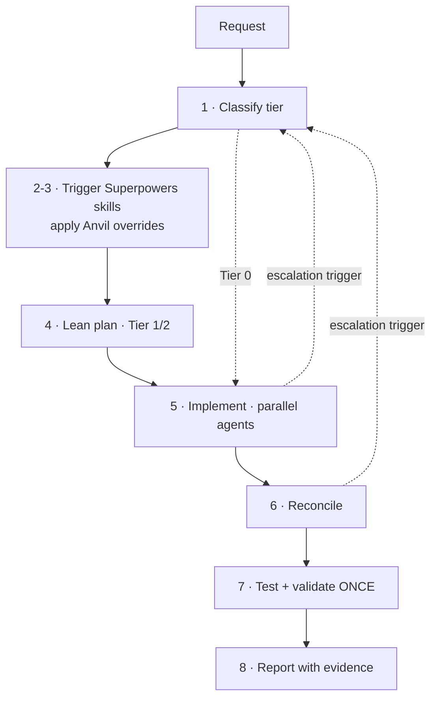

# Anvil — the workflow governor

Superpowers is written for a generic codebase and applies its full ceremony to
every change. Most real product work doesn't need that everywhere: red-green
cycles around presentational or glue code, plans that restate the implementation
as prose, and a full validate pass after every step mostly find nothing and burn
the budget. Anvil is the correction layer.

**When Anvil and a Superpowers skill disagree, Anvil wins.**
`superpowers:using-superpowers` says a matching skill is non-negotiable, and in
general it's right — but the user's own workflow instructions outrank it, and
Anvil is those instructions. Following Anvil is following the *more specific*
rule, not rationalizing out of a skill. If the project ships its own workflow
rule (a `.claude/rules/` file, a CLAUDE.md section), that rule is the binding
version and wins over this recap; Anvil is the operating detail.

## Decision procedure

Anvil is a controller, not a reading. Run these in order — two agents handed the
same request should reach the same workflow, so don't improvise the sequence.

1. **Classify the tier** (Tier 0/1/2, below). Everything downstream keys off it.
2. **Name the Superpowers skills the request would trigger** — typically some of
   `brainstorming`, `writing-plans`, `test-driven-development`,
   `dispatching-parallel-agents`, `executing-plans`, `systematic-debugging`.
3. **Apply the override table** to each: dropped, reshaped, or kept. A skill not
   in the table is kept as written.
4. **Plan** — Tier 1/2 only. Tier 0 goes straight to step 5.
5. **Implement**, fanning out to parallel agents wherever tasks are
   parallel-safe (defined below — check it, don't eyeball it).
6. **Reconcile** the agents' work and resolve conflicts before anything else.
7. **Test, then verify — once**, using the fixed sequence in [Verification](#verification).
8. **Report** with fresh evidence. No done/passing claim without it.

At any step, if an [escalation trigger](#when-to-stop-and-escalate) fires, stop
and reassess the tier and plan rather than pressing on.



## What Anvil overrides

| Superpowers skill | Its default | Anvil's ruling | Why |
| --- | --- | --- | --- |
| `test-driven-development` | Iron Law: no production code without a failing test first | **Implement first, then test the layers that earn it.** TDD demoted, not deleted — see [Non-negotiable floor](#non-negotiable-floor) | See the thing run before it's frozen by tests. Red-green on a thin wrapper tests the framework, not the code |
| `writing-plans` | Comprehensive plan: full code, full tests, bite-sized tasks | **Lean contract plan** — files + intent + pinned contracts, never full code | Code written twice is code that drifts. The plan fixes decisions, it is not the diff |
| `dispatching-parallel-agents` | Use when 2+ independent tasks exist | **Default to parallel; justify sequential** — against the parallel-safe test, not a vibe | Wall-clock is the scarce resource. Sequential-by-habit is the biggest waste |
| `verification-before-completion` | Verify before claiming done | **Kept in full — but as one pass at the end**, owned by the orchestrator | N agents each running the full validate is N type-check+lint passes for one answer |
| `brainstorming` | Required before creative work | **Tier-gated.** Skip at Tier 0/1; run it at Tier 2 | Interviewing the user about a one-file change costs more than the change |
| `subagent-driven-development` / `executing-plans` | Sequential task-by-task with checkpoints | **Parallel fan-out where the plan allows**, checkpoints only at real dependencies | Same reason as parallel dispatch |

Every other Superpowers skill is kept exactly as written — `systematic-debugging`,
`requesting-code-review`, `receiving-code-review`, `using-git-worktrees`,
`finishing-a-development-branch`. Not in the table → Anvil has no opinion; follow
it as-is.

## Tiers

If the project defines its own tier triggers, prefer those. Otherwise:

- **Tier 0** — 1 file, no new logic → implement + run the project's validate/check
  command. No plan, no tests.
- **Tier 1** — a localized change, one coherent responsibility, ≤ ~5 files → one
  lean plan. `## Key design decisions` is mandatory.
- **Tier 2** — multiple responsibilities, a new architectural boundary, a
  cross-module contract, a migration, or real design uncertainty → brainstorm the
  decisions + lean plan. Fan out independent tasks at 3+.

**Tier is about coordination complexity, not counts.** File/module counts are a
symptom, not the trigger. Two modules touched by one coherent, well-understood
change is Tier 1; one module gaining a genuinely new architectural boundary can
be Tier 2. Ask what has to be *coordinated*, not how many files are open.

**When in doubt, go lower.** An over-planned small change is the worse error —
the plan is pure overhead you can't recover. If a change brushes a Tier-2 clause
but is one responsibility you can hold in your head, say so, pick the lower tier,
and note why.

## When to stop and escalate

Speed only helps if it's pointed the right way. These are where continuing
confidently produces fast wrongness — stop, say what you found, reassess:

- The requested behavior conflicts with an existing invariant or rule.
- **A contract you need does not exist** — no endpoint, no DTO, no documented
  shape — and you'd have to invent it to proceed.
- Two modules offer competing sources of truth for the same data.
- The change requires modifying a shared abstraction you didn't expect to touch.
- The blast radius outgrows the tier you picked.
- You discover undocumented behavior that materially changes the design.

Escalating isn't failure and isn't asking permission to work — it's a short,
specific statement of what's unknown and what you assumed, delivered while the
work is still cheap to redirect. **Anything you had to invent is marked as an
assumption everywhere it appears**, including in the plan's pinned contracts. An
invented contract presented as settled is worse than none — the pin is what
everyone downstream trusts.

## Lean plan template

A plan is a **contract**, not a transcript. Code is written **once**, in the
file. Shape = stable frontmatter + an invariant core + task-fitted optional
sections — not one rigid heading order. Plans live where the project's doc rule
says; default `docs/plans/YYYY-MM-DD-<topic>.md`.

**A plan is lean enough when it removes implementation ambiguity — not when it is
short.** ~90–180 lines typical, up to ~250 for large refactors. The test:
could another agent implement it without rediscovering your design? "Update
service / update hook / add tests" is short and useless — it pushes every real
decision onto whoever picks it up. Cut restatement and code, never decisions.

**Frontmatter (every plan):**

```yaml
---
name: Short title
overview: 1–2 sentence summary of what ships.
todos:
  - id: stable-slug
    content: One actionable task description.
    status: pending   # pending | in_progress | completed
    parallel: true     # or: depends-on: <other-id>
---
```

`todos:` is the whole task tracker — it replaces any checkbox tree. Mark each one
parallel-safe or name what it depends on; that annotation is what lets the
implementation step fan out without re-deriving the dependency graph.

**Invariant core** (roughly this order; wording may vary):

- **Title** + **`## Goal`** — bulleted outcomes.
- **File map** (`## Target Files`) — each file with a one-line responsibility, as
  clickable repo-relative links.
- **Implementation steps** — prose naming the **file(s)** and the **intent**.
  Small illustrative snippets are fine (a signature, a docblock shape). No full
  implementations, no full test bodies.
- **A mermaid diagram** when it earns its place (data flow, delivery order, a
  decision map). Omit if it adds nothing.
- **`## Verification`** — exact commands + what to confirm. Tests appear as
  described scenarios ("inside window + sufficient balance → 201"), never as code.
- **`## Open questions`** — anything you assumed rather than confirmed, and who
  can settle it. Omit only when there genuinely are none; an empty section is a
  signal, not a formality.

**Data-tier contracts — required even in a lean plan.** When a step touches the
data/service/API layer, pin the contract, because that's where
under-specification silently regresses caching and error handling:

- exact **input/output (DTO) shape**, validated at the boundary
- **cache key(s)** and what **invalidates** them
- **fallback behavior** (offline/stub/feature-flag paths)
- **error mapping** — which user-facing error category each failure maps to

(These are the generic form of a web app's query-key / invalidate-keys /
mapError contract; adapt to the stack.) Mark any you inferred rather than
confirmed — see [escalation](#when-to-stop-and-escalate).

**Optional sections** — omit freely: `## Data Sources`, `## Routing Strategy`,
`## Risks and Mitigations`, `## Out of scope`, `## Success criteria`, `## Notes`.
Exception: `## Key design decisions` is **mandatory at Tier 1** — it stands in
for the spec, so an empty one means the design was skipped, not compressed.

## What earns a test

Implement, then test, then verify. "Non-trivial logic" is **layer + logic
content**, not a vibe: a unit earns a focused test when it has real branching,
mapping, fallback, or cache-key/invalidation logic; it's exempt (verify-driven)
when it's pure presentation, routing, layout, or config with no extracted logic.

| Example layer / artifact | Has branching / mapping / fallback / cache logic? | Treatment |
| --- | --- | --- |
| service / use-case function | yes | **Focused test required** |
| API / data-access function | yes | **Focused test required** |
| util / pure helper | yes | **Focused test required** |
| hook / controller with selector or orchestration logic | yes | **Focused test required** |
| pure-presentational component | no extracted logic | **Exempt — verify-driven** |
| page / route / layout shell | no extracted logic | **Exempt — verify-driven** |
| styling / theming / config | n/a | **Exempt — verify-driven** |

"Verify-driven" = type-check + lint + build + run/visual, no unit test. A test on
a service's error mapping catches real regressions; a test asserting a
presentational component renders its props catches nothing the type-checker and a
glance at the running app don't.

## Parallel-safe

Two tasks are parallel-safe **only** when both hold:

1. their **write sets are disjoint** — no file touched by both, and
2. neither depends on the other's **implementation decisions or generated
   artifacts**.

Independence is about writes and decisions, not topic. Tasks that merely sound
unrelated routinely fail both tests.

**Keep sequential when:** two tasks modify the same file (a shared barrel/export
or a URL/constants file counts); one establishes a type or API contract the other
consumes; both alter the same architectural boundary; ordering matters (a
migration); one task's output determines how the other is implemented; or the two
would need a coordinated design decision to agree.

The fix for a contract dependency is not to serialize everything: pin the contract
in the plan first, or land it as a small blocking task, and the consumers become
parallel-safe. That conversion is most of what a good decomposition does.

**Actually executing the fan-out:** dispatch one subagent per parallel-safe task
in a single turn via the `Agent` tool; for longer-lived workers use the
`claude-session-driver` plugin, and for a structured multi-stage pipeline the
`Workflow` tool (when the user has opted into orchestration). Describing
parallelism you never execute is the thing Anvil exists to prevent.

## Verification

One phase, at the end, owned by the orchestrator. The phases are distinct — this
is what makes "only type-check mid-flight" and "run the narrow suite at the end"
compatible rather than contradictory. Substitute your stack's commands for the
examples:

| Phase | Who | Commands (examples) |
| --- | --- | --- |
| Implementation | Each agent | type-check only (`npm run type-check`, `tsc --noEmit`, `mypy`, `go build`) — **and nothing else** |
| Reconcile | Orchestrator | the same type-check after merging the agents' work |
| Test + fix loop | Orchestrator | author the required tests, then run the **narrowest** suite that answers the question (`npx vitest run <module>`, `pytest <path>`), repeat until green |
| Final | Orchestrator | full validate once (`npm run validate`); build if files were added/moved/deleted; run/visual check when UI changed |

Agents never run a test suite or the full validate. The full suite runs only in
the final pass. Interleaved verification costs far more wall-clock than the
defects it catches, and catches none this pass would miss.

**One early exception:** a change whose blast radius is unknown — a shared theme
token, a router table, a code generator — gets verified as soon as it lands,
because a failure found at the end would invalidate everything built on top.

## Speed levers

- **Parallel agents — the biggest wall-clock win.** One agent per parallel-safe
  task, all dispatched in a single turn. Each gets a focused, self-contained
  brief (its files + its intent + expected output) and inherits none of your
  history. **Every brief must say what NOT to do**, because a subagent inherits
  none of this context and will otherwise run the full validate itself. Include
  verbatim:

  ```text
  Implement only. Do not author tests and do not run any test suite or the full
  validate command — type-check is the only check you may run. The orchestrator
  verifies once, after all agents land.
  ```

- **Cheapest capable model** for mechanical work (renames, config tweaks) —
  reserve the strong model for design and judgment.
- **File-based handoffs** — pass plans and findings as files to keep the
  orchestrator's context small instead of inlining everything.
- **On a large codebase, query the graph, don't re-read files** — if a
  `graphify-out/` graph exists (the `graphify` skill), traverse it to locate code
  instead of grepping/reading raw files; recall prior decisions via the
  `episodic-memory` plugin rather than re-deriving them.
- **Continuous execution** — run independent tasks back-to-back. Don't stop to
  ask "should I continue?" between them.
- **Batched fixes** — one fixer agent gets the full findings list at once, not
  one agent per finding.

## Non-negotiable floor

Anvil buys speed by cutting duplication and right-sizing ceremony. Never by
skipping these:

- **Fresh verification evidence before any done/passing claim** — from the single
  end-of-work pass, not a run per step. Deferring verification is not skipping it;
  "I didn't run it" is never a substitute.
- **TDD is demoted, not deleted.** Reach for a real red-green cycle when a test is
  the cheapest way to pin down behavior you can't otherwise trust: a reported bug
  you must reproduce before fixing, a gnarly pure function with many branches, or
  a contract another module depends on. A real call, not a loophole — the default
  is still implement-first.
- **Assumptions are labelled**, in the plan and the report. Speed that hides what
  you invented is not speed.
- **Branch safety** — no work on `main`/`master` without consent.
- **A review pass before merge.**
- **Resolve the warnings that matter; never hide any.** No lint-disable to mask
  output.

## Anti-slop posture

Binding on every change Anvil governs, at every tier, and in every subagent brief:

1. **Preserve behavior.** Don't change unrequested visual styles or logic unless
   explicitly instructed.
2. **Minimize changes.** Keep diffs small, clean, tight. Avoid unnecessary
   refactoring.
3. **Reuse utilities.** Check existing architecture and patterns first. Don't
   reinvent the wheel with redundant helpers.
4. **Strip boilerplate.** Avoid over-defensive error handling at trusted internal
   boundaries, verbose comments, or future-proofing abstractions.
5. **Be concise and evidence-dense.** Provide the necessary fixes without
   conversational fluff, throat-clearing, or over-explanation.
